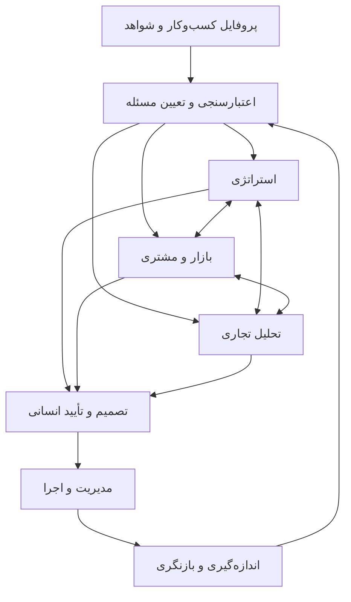

# معماری پایپلاین تصمیم‌سازی بازاریابی (M-Tools) — پیش‌نویس v0.1

این سند مکمل [بانک شایستگی نسخه ۲](marketing-manager-competency-framework.md) است. هدف، تبدیل روش‌های قابل صورت‌بندی به ابزار تصمیم‌سازی برای یک مدیر عمومی بازاریابی است، نه ایجاد نقش‌های مدیریتی مجزا یا ادعای جایگزینی قضاوت انسانی.

## ۱. ساختار منطقی

چهار موتور: S استراتژی و حل مسئله؛ M شناخت بازار، مشتری و رقابت؛ B تحلیل تجاری و تصمیم مبتنی بر داده؛ E مدیریت و اجرا. زیرحوزه‌ها در سطح مسئله/ابزار تعریف شده‌اند. هر ابزار می‌تواند چند روش معتبر و متناسب با داده داشته باشد؛ فهرست روش‌ها انتخاب اولیه طراحی است، نه اثبات اعتبار علمی یا تضمین مناسب بودن برای هر شرکت.

وابستگی‌ها مبتنی بر ورودی معتبر و نسخه خروجی‌اند؛ ترتیب ثابت و اجرای هر چهار موتور در هر مسئله الزامی نیست. موتور E ظرفیت را پیش از تصمیم نیز گزارش می‌کند. یکپارچه‌سازی خروجی‌ها در لایه مشترک تصمیم‌گیری انجام می‌شود؛ موتور پنجم تخصصی ایجاد نمی‌شود.

## ۲. کاتالوگ زیرحوزه‌ها و ابزارهای پیشنهادی

| شناسه ابزار | زیرحوزه / ابزار | سؤال تصمیم | روش پیشنهادی | ورودی | خروجی قابل بازبینی | شناسه‌های بانک |
|---|---|---|---|---|---|---|
| S01 | تشخیص مسئله و علل | چرا نتیجه مطلوب حاصل نمی‌شود؟ | درخت مسئله، تحلیل علّی، فرضیه‌های رقیب | اهداف، عملکرد، شواهد و محدودیت | نقشه مسئله، علل احتمالی و آزمون بعدی | 59, 113, 114, 115 |
| S02 | مدل کسب‌وکار و مزیت رقابتی | چگونه ارزش ایجاد و کسب می‌شود؟ | Business Model Canvas، تحلیل زنجیره ارزش، ارزیابی مزیت | محصول، مدل درآمد، هزینه و رقبا | نقشه مدل و فرضیات مزیت | 6, 25, 26 |
| S03 | اهداف و انتخاب استراتژی | کجا رقابت کنیم و چگونه؟ | درخت اهداف، گزینه‌های استراتژیک، تحلیل trade-off | مسئله، اهداف سازمان، بینش بازار و منابع | اهداف، گزینه‌ها، انتخاب و منطق آن | 1, 2, 3 |
| S04 | فرصت و اولویت‌بندی | کدام فرصت ارزش سرمایه‌گذاری دارد؟ | ماتریس جذابیت-توانمندی، MCDA، حساسیت وزن‌ها | فرصت‌ها، اثر، هزینه، ریسک | رتبه فرصت‌ها و سناریوهای جایگزین | 4, 5 |
| S05 | سناریو و تصمیم‌گیری در عدم قطعیت | اگر شرایط تغییر کند چه کنیم؟ | سناریونویسی، تحلیل حساسیت، ارزش اطلاعات | فرضیات، عدم قطعیت و گزینه‌ها | سناریو، نقاط بازنگری و تصمیم مشروط | 8, 33, 116 |
| S06 | استراتژی رشد و ورود به بازار | از چه مسیر و کانالی رشد کنیم؟ | GTM، مقایسه کانال، طراحی جذب و حفظ مشتری | بازار هدف، محصول، اقتصاد واحد و ظرفیت | گزینه GTM، راهبرد جذب/نگهداشت و توزیع | 52, 57, 58, 73, 86 |
| M01 | طراحی و اجرای تحقیقات بازار | چه داده‌ای برای تصمیم لازم است و چگونه به دست آید؟ | طرح تحقیق، نمونه‌گیری، پرسشنامه، مصاحبه نیمه‌ساختاریافته، کدگذاری | سؤال تصمیم، جامعه، داده موجود، بودجه | طرح تحقیق، داده معتبر، گزارش و محدودیت | 9, 20 |
| M02 | اندازه بازار و تقاضا | بازار چقدر بزرگ است و چگونه تغییر می‌کند؟ | برآورد بالا به پایین/پایین به بالا، TAM/SAM/SOM، روند | آمار بازار، جمعیت، نرخ خرید و قیمت | دامنه اندازه بازار و سناریوی تقاضا | 14, 16 |
| M03 | رقبا و محیط | چه عوامل بیرونی بر رقابت اثر دارند؟ | PESTEL، پنج نیروی پورتر، بنچمارک | داده رقبا، صنعت، محیط کلان | ماتریس رقابت و فرصت/تهدید مستند | 10, 15 |
| M04 | رفتار، نیاز و انگیزه مشتری | چرا مشتری خرید می‌کند یا نمی‌کند؟ | JTBD، تحلیل مضمون، تحلیل رفتار و سوگیری | مصاحبه، مشاهده، تراکنش و بازخورد | نقشه نیاز، انگیزه، موانع و فرضیات | 17, 18, 19, 23, 24, 82 |
| M05 | بخش‌بندی و انتخاب بازار هدف | کدام گروه را هدف بگیریم؟ | بخش‌بندی مبتنی بر نیاز/رفتار، خوشه‌بندی در صورت کفایت داده، جذابیت بخش | داده مشتری، اندازه و اقتصاد بخش | بخش‌ها، ICP و انتخاب هدف مستدل | 11, 12, 21 |
| M06 | جایگاه‌یابی و ارزش پیشنهادی | چرا مخاطب ما را انتخاب کند؟ | STP، نقشه ادراکی، آزمون مفهوم/پیام | مشتری هدف، رقبا، ویژگی و منفعت محصول | بیانیه جایگاه، ارزش پیشنهادی و شواهد | 13, 42, 49, 51 |
| M07 | محصول و اعتبارسنجی تناسب بازار | محصول تا چه حد نیاز واقعی را حل می‌کند؟ | تحلیل cohort، آزمون مفهوم، چرخه عمر، بازخورد محصول | داده محصول، استفاده، خرید مجدد، بازخورد | شواهد PMF، اولویت بهبود و مرحله عمر | 50, 54, 55 |
| M08 | برند، ادراک و شهرت | برند چگونه در ذهن بازار شکل گرفته است؟ | پایش آگاهی و تداعی، ممیزی برند، معماری برند | تحقیقات برند، پیام، رقبا، بازخورد | استراتژی برند، هویت، شکاف ادراک و ریسک شهرت | 41, 43, 44, 45, 46, 47, 48 |
| M09 | سفر و تجربه مشتری | کجا تجربه مشتری مختل است؟ | Journey mapping، تحلیل بازخورد و شکایت | رویدادها، مصاحبه، نظرسنجی و شکایت | نقشه سفر، نقاط درد و اولویت بهبود | 22, 84, 85 |
| B01 | اقتصاد واحد و سودآوری | آیا رشد سودآور است؟ | حاشیه مشارکت، CAC/LTV، ROMI، تحلیل هزینه | درآمد، هزینه، حاشیه و داده cohort | اقتصاد واحد، سودآوری و محدودیت داده | 28, 29, 30, 37 |
| B02 | قیمت‌گذاری و پیش‌بینی | قیمت و حجم فروش چه اثری دارند؟ | نقطه سربه‌سر، کشش، مدل پیش‌بینی و حساسیت | قیمت، فروش، هزینه، تاریخچه و فرضیات | سناریوی قیمت، پیش‌بینی و نقطه سربه‌سر | 31, 32 |
| B03 | قیف، تبدیل و ریزش | افت عملکرد در کدام مرحله است؟ | تحلیل قیف، cohort، survival در صورت مناسب بودن داده | رویدادها، فروش، تاریخ و شناسه مشتری | نرخ تبدیل، ریزش و گلوگاه مستند | 36, 60, 62 |
| B04 | آزمایش و اندازه‌گیری اثر | آیا تغییر واقعاً ناشی از اقدام ماست؟ | A/B، گروه کنترل، طرح شبه‌آزمایشی در صورت امکان، انتساب با محدودیت | فرضیه، داده پایه، متریک و طراحی نمونه | طرح آزمایش، برآورد اثر، عدم قطعیت | 38, 39 |
| B05 | شاخص، تحلیل و گزارش | آیا عملکرد به هدف نزدیک است؟ | درخت KPI، تحلیل توصیفی، کنترل کیفیت و داشبورد | تعریف شاخص، داده مالی و رویدادی | داشبورد، تفسیر، هشدار کیفیت و انحراف | 34, 35, 40, 74 |
| B06 | سبد محصول و سرمایه‌گذاری | کدام محصول یا اقدام منابع بیشتری بگیرد؟ | تحلیل حاشیه، رشد و ریسک، مقایسه بازده افزایشی | فروش محصول، هزینه، ظرفیت و گزینه‌ها | رتبه‌بندی سبد و توصیه سرمایه‌گذاری | 56 |
| E01 | برنامه‌ریزی، بودجه و منابع | چگونه تصمیم را به برنامه قابل اجرا تبدیل کنیم؟ | WBS، بودجه‌ریزی، ظرفیت‌سنجی و زمان‌بندی | استراتژی تأییدشده، بودجه، ظرفیت و وابستگی | برنامه سالانه/فصلی، بودجه، مالک و موعد | 7, 27, 97, 98, 100, 101 |
| E02 | کمپین، محتوا و خلاقیت | چگونه پیام و کمپین اجرا شود؟ | IMC، بریف خلاق، برنامه محتوا، آزمون پیام | جایگاه، مخاطب، اهداف و کانال‌ها | پیام، بریف، تقویم و برنامه کمپین | 65, 66, 67, 68, 69, 70, 71, 72, 99 |
| E03 | کانال‌ها و رسانه | ترکیب رسانه و اجرا چگونه باشد؟ | برنامه‌ریزی رسانه، ممیزی SEO/SEM، تخصیص کانال | بودجه، مخاطب، عملکرد کانال و محدودیت | برنامه کانال، الزامات اجرا و معیار پذیرش | 75, 76, 77, 78, 79, 80, 88 |
| E04 | فروش، عرضه و چرخه مشتری | چگونه مشتری جذب، تبدیل و حفظ شود؟ | SLA فروش، امتیازدهی سرنخ، طرح عرضه، lifecycle | GTM، قیف، CRM، ظرفیت فروش و محصول | برنامه عرضه، سرنخ، فروش مجدد، وفاداری و هماهنگی | 53, 61, 63, 64, 81, 83, 87 |
| E05 | عملیات، داده و فناوری | چه فرایند و ابزار عملیاتی لازم است؟ | نقشه فرایند، ارزیابی MarTech، قرارداد داده و کنترل کیفیت | فرایندها، سیستم‌ها، داده و نیازمندی | گردش‌کار، طرح CRM/اتوماسیون، مشخصات اتصال و انتخاب ابزار | 89, 90, 91, 92, 93, 94, 95, 96, 102 |
| E06 | تیم، پیمانکار و توسعه افراد | چه کسی مسئول چه کاری است؟ | RACI، مصاحبه ساختاریافته، بازخورد رفتاری و برنامه توسعه | نقش، ظرفیت، نمونه کار، اهداف و محدودیت | ماتریس مسئولیت، بریف پیمانکار، برنامه توسعه | 103, 105, 106, 107, 108, 109 |
| E07 | ذی‌نفعان، تعارض و ارتباط | چگونه توافق و تعارض مدیریت شود؟ | نقشه ذی‌نفعان، مذاکره مبتنی بر منافع، چارچوب بازخورد | منافع طرفین، تصمیم و محدودیت | پیشنهاد گفت‌وگو، تصمیم ثبت‌شده و مسیر ارجاع | 110, 111, 112, 118 |
| E08 | حاکمیت، اخلاق و یادگیری | چگونه ریسک و خطا کنترل شود؟ | ثبت ریسک، چک‌لیست حریم خصوصی، بازنگری دوره‌ای و postmortem | نتایج، داده حساس، الزامات و گزارش انحراف | کنترل، توقف/ارجاع، درس‌آموخته و اصلاح برنامه | 104, 117, 119, 120 |

## ۳. تحقیقات بازار — نمونه تجزیه پایپلاین M01

تحقیقات بازار صرفاً تحلیل داده موجود نیست و تولید شواهد جدید را نیز شامل می‌شود.

| مرحله | ابزار | ورودی | خروجی / کنترل |
|---|---|---|---|
| تعریف سؤال | سازنده بریف تحقیق | تصمیم، مجهولات، بودجه | سؤال قابل پاسخ، هدف و معیار استفاده |
| انتخاب روش | طراحی تحقیق | جامعه، نوع سؤال، داده موجود | طرح کمی/کیفی/ترکیبی، دلیل انتخاب |
| نمونه‌گیری | طراح نمونه | چارچوب نمونه، دقت و محدودیت | طرح نمونه؛ برآورد حجم فقط با فرض‌های معتبر |
| گردآوری | پرسشنامه، راهنمای مصاحبه و ثبت شواهد | طرح و رضایت لازم | پاسخ واقعی، منشأ داده و ثبت عدم پاسخ |
| کنترل کیفیت | بررسی سوگیری و اعتبار | داده خام، طرح، داده مفقود | گزارش پوشش، ناسازگاری و محدودیت |
| تحلیل | تحلیل کمی یا کدگذاری کیفی | داده قابل استفاده | برآورد، عدم قطعیت یا مضامین با شواهد |
| تصمیم | گزارش بینش | یافته‌ها و سؤال اولیه | پاسخ مستند، فرضیه باقی‌مانده و تصمیم پیشنهادی |

تحقیق ثانویه، داده رسمی، داده داخلی و داده اولیه متمایز می‌شوند. هیچ پاسخ پیمایش، مصاحبه، اندازه بازار یا شواهد ساختگی توسط AI تولید نمی‌شود. در صورت نبود شواهد، ابزار برنامه جمع‌آوری داده یا نتیجه مشروط می‌دهد.

## ۴. قرارداد مشترک ابزارها

ورودی پایه: شناسه شرکت/پروژه، سؤال تصمیم، هدف، داده مرتبط، بازه زمانی، واحد اندازه‌گیری و محدودیت. داده‌ها فقط در صورت نیاز مطالبه شوند.

خروجی پایه: شناسه اجرا، نسخه داده و روش، وضعیت (آماده/نیازمند داده/مشروط/خطا)، یافته‌ها، گزینه‌ها، فرضیات، منابع، محدودیت، عدم قطعیت، اقدام پیشنهادی، مالک تأیید و تاریخ بازنگری.

موجودیت‌های مشترک: BusinessProfile، Product، CustomerSegment، Competitor، Evidence، MetricDefinition، Observation، Hypothesis، AnalysisRun، Decision، ActionPlan، Outcome. ارتباط‌ها با شناسه و نسخه؛ داده خام از تفسیر و تصمیم جدا باشد. مقدار ناشناخته با صفر یکسان نیست. دسترسی به اطلاعات شخصی و مالی حداقلی و مبتنی بر نقش باشد.

## ۵. طبقه‌بندی قابلیت تبدیل به ابزار

- A: محاسبه یا پردازش تکرارپذیر قابل خودکارسازی پس از اعتبارسنجی داده و فرض‌ها؛ تفسیر نهایی همچنان ممکن است انسانی باشد.
- D: تصمیم‌یار؛ ابزار تحلیل، ساختار، پیشنهاد یا پیش‌نویس می‌دهد اما کیفیت و انتخاب باید بررسی شود.
- H: قضاوت، مسئولیت یا رفتار انسانی؛ ابزار فقط ساختار و مستندات پشتیبان فراهم می‌کند.

این برچسب‌ها درباره قابلیت تبدیل به ابزارند، نه نمره شایستگی یا میزان ضرورت. برچسب غالب پیشنهادی است.

| نوع | تعداد |
|---|---:|
| A | 13 |
| D | 79 |
| H | 28 |
| مجموع | 120 |

## ۶. ماتریس ردیابی کامل بانک

هر ID دقیقاً یک مالک اصلی دارد؛ وابستگی فرعی میان موتورها مجاز است. پوشش ردیابی به معنای پیاده‌سازی ابزار یا اعتبارسنجی روش نیست.

| ID | قابلیت بانک | ابزار اصلی | نوع تبدیل |
|---:|---|---|---|
| 1 | تفکر استراتژیک (Strategic Thinking) | S03 | H |
| 2 | تدوین استراتژی بازاریابی (Marketing Strategy) | S03 | H |
| 3 | هم‌راستا کردن اهداف مارکتینگ با اهداف کسب‌وکار | S03 | H |
| 4 | اولویت‌بندی فرصت‌ها و تخصیص منابع | S04 | H |
| 5 | شناسایی فرصت‌های رشد و توسعه بازار | S04 | D |
| 6 | تحلیل مزیت رقابتی پایدار | S02 | D |
| 7 | تدوین برنامه سالانه و فصلی بازاریابی | E01 | D |
| 8 | برنامه‌ریزی سناریویی و پیش‌بینی تغییرات بازار | S05 | D |
| 9 | تحقیقات بازار (Market Research) | M01 | D |
| 10 | تحلیل رقبا (Competitor Analysis) | M03 | D |
| 11 | بخش‌بندی بازار (Segmentation) | M05 | D |
| 12 | انتخاب بازار هدف (Targeting) | M05 | H |
| 13 | جایگاه‌یابی (Positioning) | M06 | H |
| 14 | برآورد اندازه و ظرفیت بازار (TAM, SAM, SOM) | M02 | A |
| 15 | تحلیل محیط کلان (PESTEL) | M03 | D |
| 16 | تحلیل روندهای بازار و تغییر الگوهای تقاضا | M02 | D |
| 17 | شناخت رفتار مصرف‌کننده | M04 | D |
| 18 | کشف نیازها و مشکلات واقعی مشتری | M04 | H |
| 19 | شناخت انگیزه‌ها و موانع خرید | M04 | D |
| 20 | انجام مصاحبه عمیق با مشتریان | M01 | D |
| 21 | تدوین پرسونای مشتری و پروفایل مشتری ایده‌آل (ICP) | M05 | D |
| 22 | تحلیل سفر مشتری (Customer Journey) | M09 | D |
| 23 | درک چارچوب کار مورد انتظار مشتری (Jobs to Be Done) | M04 | D |
| 24 | شناخت اقتصاد رفتاری و سوگیری‌های شناختی | M04 | D |
| 25 | درک مدل کسب‌وکار | S02 | D |
| 26 | درک مدل درآمدی | S02 | D |
| 27 | بودجه‌بندی و مدیریت بودجه مارکتینگ | E01 | D |
| 28 | درک درآمد، سود، هزینه و حاشیه سود | B01 | A |
| 29 | تحلیل اقتصاد واحد مشتری یا محصول (Unit Economics) | B01 | A |
| 30 | تحلیل بازگشت سرمایه بازاریابی (ROI/ROMI) | B01 | A |
| 31 | تدوین استراتژی قیمت‌گذاری | B02 | D |
| 32 | پیش‌بینی درآمد، فروش و نقطه سربه‌سر | B02 | A |
| 33 | تصمیم‌گیری مبتنی بر داده و شواهد | S05 | H |
| 34 | تعریف شاخص‌های کلیدی عملکرد (KPI) | B05 | D |
| 35 | تحلیل و تفسیر داده‌های بازاریابی | B05 | D |
| 36 | تحلیل قیف بازاریابی و فروش | B03 | A |
| 37 | تحلیل CAC، LTV، نرخ تبدیل و نرخ ریزش | B01 | A |
| 38 | طراحی آزمایش و آزمون A/B | B04 | D |
| 39 | تحلیل انتساب نتایج به کانال‌ها (Attribution) و اثر افزایشی بازاریابی | B04 | D |
| 40 | طراحی داشبورد و گزارش تحلیلی عملکرد | B05 | A |
| 41 | تدوین استراتژی برند | M08 | D |
| 42 | طراحی ارزش پیشنهادی (Value Proposition) | M06 | H |
| 43 | تعریف هویت، شخصیت و لحن برند | M08 | D |
| 44 | مدیریت تصویر ذهنی و ادراک مخاطبان از برند | M08 | D |
| 45 | تحلیل و سنجش ارزش ویژه برند (Brand Equity) | M08 | A |
| 46 | ایجاد تمایز و انسجام برند | M08 | D |
| 47 | مدیریت اعتبار و شهرت برند | M08 | D |
| 48 | مدیریت معماری برند و سبد برندها | M08 | D |
| 49 | شناخت عمیق محصول و خدمات سازمان | M06 | D |
| 50 | تشخیص تناسب محصول با بازار (Product-Market Fit) | M07 | D |
| 51 | تبدیل ویژگی‌های محصول به منافع ملموس برای مشتری | M06 | D |
| 52 | تدوین استراتژی ورود به بازار (Go-to-Market) | S06 | D |
| 53 | طراحی و مدیریت عرضه محصول جدید | E04 | D |
| 54 | تحلیل چرخه عمر محصول | M07 | D |
| 55 | مشارکت در توسعه محصول بر اساس نیاز بازار | M07 | D |
| 56 | تحلیل سبد محصولات و عملکرد تجاری آن‌ها | B06 | A |
| 57 | طراحی استراتژی جذب مشتری | S06 | D |
| 58 | طراحی استراتژی حفظ مشتری | S06 | D |
| 59 | شناسایی گلوگاه‌های رشد کسب‌وکار | S01 | D |
| 60 | بهینه‌سازی نرخ تبدیل (CRO) | B03 | D |
| 61 | مدیریت چرخه عمر مشتری (Lifecycle Marketing) | E04 | D |
| 62 | تحلیل و کاهش ریزش مشتری (Churn) | B03 | A |
| 63 | طراحی استراتژی فروش مجدد، مکمل و ارتقای خرید | E04 | D |
| 64 | طراحی سیستم معرفی مشتری و وفادارسازی | E04 | D |
| 65 | طراحی پیام بازاریابی (Messaging) | E02 | D |
| 66 | تدوین استراتژی ارتباطات یکپارچه بازاریابی (IMC) | E02 | D |
| 67 | تفکر خلاق و ایده‌پردازی | E02 | D |
| 68 | تدوین استراتژی بازاریابی محتوایی | E02 | D |
| 69 | داستان‌سرایی (Storytelling) | E02 | D |
| 70 | شناخت اصول کپی‌رایتینگ و اقناع مخاطب | E02 | D |
| 71 | تدوین بریف خلاقانه و ارزیابی خروجی تیم تولید محتوا | E02 | D |
| 72 | شناخت اصول طراحی بصری و هدایت هنری | E02 | D |
| 73 | تدوین استراتژی دیجیتال مارکتینگ | S06 | D |
| 74 | شناخت بازاریابی عملکردی (Performance Marketing) | B05 | D |
| 75 | شناخت اصول سئو (SEO) | E03 | D |
| 76 | شناخت تبلیغات موتورهای جست‌وجو (SEM/PPC) | E03 | D |
| 77 | شناخت بازاریابی شبکه‌های اجتماعی | E03 | D |
| 78 | شناخت ایمیل مارکتینگ و بازاریابی مستقیم دیجیتال | E03 | D |
| 79 | برنامه‌ریزی رسانه و ترکیب کانال‌ها (Media Planning) | E03 | D |
| 80 | مدیریت اینفلوئنسر مارکتینگ و افیلیت مارکتینگ | E03 | D |
| 81 | ایجاد هماهنگی میان مارکتینگ و فروش | E04 | H |
| 82 | درک فرایند فروش و موانع تبدیل مشتری | M04 | D |
| 83 | مدیریت سرنخ‌های فروش و ارزیابی کیفیت آن‌ها | E04 | D |
| 84 | مدیریت تجربه مشتری (CX) | M09 | D |
| 85 | تحلیل بازخورد، رضایت و شکایات مشتریان | M09 | D |
| 86 | تدوین استراتژی کانال‌های فروش و توزیع | S06 | D |
| 87 | توانمندسازی تیم فروش (Sales Enablement) | E04 | D |
| 88 | شناخت بازاریابی تجاری، رویدادی و آفلاین | E03 | D |
| 89 | شناخت سیستم‌های مدیریت ارتباط با مشتری (CRM) | E05 | D |
| 90 | شناخت اتوماسیون بازاریابی | E05 | D |
| 91 | شناخت ابزارهای تحلیل وب مانند GA4 | E05 | D |
| 92 | تسلط کاربردی بر Excel و ابزارهای تحلیل داده | E05 | A |
| 93 | استفاده مؤثر از هوش مصنوعی در بازاریابی | E05 | D |
| 94 | ارزیابی و کنترل کیفیت خروجی هوش مصنوعی | E05 | H |
| 95 | انتخاب، ارزیابی و یکپارچه‌سازی ابزارهای MarTech | E05 | D |
| 96 | تسلط اجرایی بر SQL، Python یا ابزارهای تخصصی BI | E05 | A |
| 97 | تبدیل استراتژی به برنامه عملیاتی | E01 | D |
| 98 | مدیریت پروژه | E01 | D |
| 99 | طراحی و مدیریت کمپین‌های بازاریابی | E02 | D |
| 100 | مدیریت زمان و اولویت‌های اجرایی | E01 | D |
| 101 | تخصیص منابع انسانی، مالی و زمانی | E01 | H |
| 102 | طراحی و بهبود فرایندهای تیم مارکتینگ | E05 | D |
| 103 | مدیریت آژانس‌ها، پیمانکاران و تأمین‌کنندگان | E06 | D |
| 104 | مدیریت چابک و اصلاح سریع برنامه‌ها (Agile) | E08 | D |
| 105 | رهبری تیم مارکتینگ | E06 | H |
| 106 | توانایی تفویض اختیار | E06 | H |
| 107 | استخدام و تشخیص استعدادهای مناسب | E06 | H |
| 108 | ارزیابی عملکرد و ارائه بازخورد | E06 | H |
| 109 | آموزش، مربیگری و توسعه اعضای تیم | E06 | H |
| 110 | مدیریت تعارض و اختلاف‌نظر | E07 | H |
| 111 | مذاکره، متقاعدسازی و مدیریت ذی‌نفعان | E07 | H |
| 112 | ارائه مؤثر و دفاع از تصمیم‌ها در برابر مدیران ارشد | E07 | H |
| 113 | تفکر انتقادی (Critical Thinking) | S01 | H |
| 114 | حل مسائل پیچیده (Problem Solving) | S01 | H |
| 115 | تفکر سیستمی (Systems Thinking) | S01 | H |
| 116 | قدرت قضاوت و تصمیم‌گیری در شرایط عدم قطعیت | S05 | H |
| 117 | سازگاری، یادگیری مستمر و اصلاح باورهای نادرست | E08 | H |
| 118 | هوش هیجانی و مهارت ارتباط بین‌فردی | E07 | H |
| 119 | مسئولیت‌پذیری و رعایت اخلاق حرفه‌ای | E08 | H |
| 120 | شناخت الزامات حقوقی تبلیغات، حریم خصوصی و مدیریت ریسک | E08 | H |

## ۷. شکاف‌های معماری فراتر از بانک شایستگی

بانک ۱۲۰ ردیفی معیار ردیابی است، نه تعریف تمام نیازهای محصول. برای سامانه قابل اعتماد، موارد زیر نیز باید در طراحی تفصیلی پوشش داده شوند:

- رجیستری روش‌ها: شرایط کاربرد، پیش‌فرض، نسخه، منبع، شواهد اعتبار، آزمون مرجع و معیار توقف.
- اتصال و ورود داده، کنترل کیفیت، تاریخچه، تعریف مشترک شاخص، دسترسی و حریم خصوصی.
- ثبت تصمیم و اختلاف‌نظر، تأیید انسانی، تداخل محدودیت‌ها، بازبینی و امکان بازگشت.
- طراحی آزمایش، کنترل سوگیری و نشت داده، تحلیل عدم قطعیت، کنترل خروجی AI و عدم جعل شواهد.
- پشتیبانی از کسب‌وکار فاقد داده: طرح گردآوری داده و برآورد مشروط، نه عدد ظاهراً دقیق.
- پایش نتیجه و مقایسه با هدف و خط پایه؛ یادگیری مستمر بدون استنتاج علّی ناموجه.

## ۸. UX: اصول اولیه (هنوز نهایی نشده)

صفحه اصلی حول سؤال یا تصمیم کسب‌وکار باشد، نه الزام به پر کردن ده‌ها فرم. چهار موتور در ناوبری قابل دسترسی باشند و هر ابزار یک جریان ساده داشته باشد: سؤال → داده‌های لازم → روش/فرضیات → یافته‌ها → تصمیم → اقدام. اطلاعات موجود دوباره مطالبه نشود. در حالت پیشرفته، روش، محاسبه و شواهد قابل مشاهده و اصلاح باشد. فقدان داده یا تعارض نتایج آشکار نمایش داده شود.

## ۹. معیار آمادگی برای مرحله طراحی تفصیلی

- [x] ۱۲۰ شناسه بانک دارای مالک اصلی و نوع تبدیل پیشنهادی.
- [x] هر زیرحوزه سؤال تصمیم، روش، ورودی و خروجی دارد.
- [ ] اعتبارسنجی روش‌ها با منابع اولیه و شرایط کاربرد.
- [ ] تعریف طرح داده و قرارداد اجرایی هر ابزار با انواع و قواعد اعتبارسنجی.
- [ ] آزمون با کسب‌وکارهای واقعی متفاوت و بررسی شکاف‌ها با خبره.
- [x] نمونه UX و پروتکل بازنگری اولویت MVP در [Workbench Design](marketing-workbench-design.md) مستند شده‌اند؛ آزمون کاربردپذیری، جمع‌آوری داده وظایف و تأیید اولویت هنوز انجام نشده‌اند.
- [ ] پیاده‌سازی، تست محاسبات و آزمون مستقل خروجی.

این نسخه معماری مفهومی است، نه نرم‌افزار آماده یا مدل علمی اعتبارسنجی‌شده.

## مسیرهای استراتژی تخصصی روی چهار موتور
[Strategy Library](marketing-strategy-library.md) کاتالوگ ۲۶ recipe نسخه‌دار است که ۲۹ ابزار حاضر را با توجه به مسئله و داده ترکیب می‌کند. این مسیرها دسته شایستگی، ابزار یا موتور جدید نیستند؛ هر مسیر یک مالک روش، مراحل اختیاری/الزامی براساس پیش‌شرط، تصمیم S03، طرح E01 و مرور B04/B05/E08 دارد. برای جلوگیری از چرخه، وابستگی به artifact نسخه‌دار مرحله قبلی است؛ پیش‌نویس قبل از تایید و مرور در run بعدی. سیاست عدم داده و وضعیت MVP بدون تغییر.

## مسیرهای برنامه‌ریزی و کنترل اجرا
[Marketing Planning Library](marketing-planning-library.md) الگوهای PL01–PL34 را بر تصمیم S03 و خروجی ۲۹ ابزار تعریف می‌کند. E01 یکپارچه‌کننده برنامه، WBS، زمان، منابع، هزینه و acceptance؛ تخصص محتوا در ابزار مالک مربوطه. وابستگی مراحل recipe به artifact نسخه‌دار و وابستگی taskها به Action مستقل‌اند. قبل از تأیید فقط پیش‌نویس؛ feasibility و reconciliation قبل از baseline؛ actual/forecast و E08 review پس از اجرای واقعی، اصلاح در نسخه بعدی. هیچ موتور جدید و تغییر mode/MVP لازم نیست.

## زیرمسیر جایگاه‌سازی در چهار موتور
[Positioning Library](marketing-positioning-library.md) PO01–PO14 را در M06/M08 و ابزارهای پژوهش/تحلیل حاضر تعریف می‌کند: M01 research → M04/M08 diagnosis → M06/S04 options → S03 approval → PL13/E01 activation → B04/B05/E08 measurement. ابزارها حسب داده/مسئله؛ preview و draft قبل از approval؛ feedback run جدید، no cyclic dependency. بدون تغییر چهار موتور، ۲۹ ابزار، ۱۲۰ competency یا roadmap.

## مسیر مستقل Workbench

[Workbench Design](marketing-workbench-design.md) لایه Quick و Knowledge و شخصی‌سازی را بر همان ابزارها تعریف می‌کند. Quick دستی بدون Workspace، وابستگی یا pipeline و بدون ثبت AnalysisRun؛ ذخیره صریح نتیجه/تحلیل کامل در workspace با شواهد و مجوز. QTهای محدود می‌توانند قبل از ابزار کامل مالک پس از validation خود عرضه شوند؛ هیچ recipe یا مرحله domain/full با صرف فعال بودن QT آماده تلقی نشود. سه mode single/domain/full، مالکیت artifact، تأیید انسانی و ۲۹ ابزار تغییر نمی‌کنند. اولویت ابزارهای کامل فعلاً هشت مورد اولیه و B05 پایه است؛ F-03 بررسی وظایف و تصمیم مالک و F-05 پایلوت مقایسه بهره‌وری را تعریف می‌کند.

## تکمیل رقابتی Workbench

[Competitive Enhancements](marketing-competitive-enhancements.md) ۱۱ قابلیت منتخب روی registry موجود: template/demo و import validation، export مدیریتی از artifact، LessonRecord E08، intake پروفایل/استراتژی draft، چهار connector read-only GA4/Google Ads/Search Console/CRM، روش‌های B02/M06/B01/M09. هیچ connector اجتماعی، pipeline mode، full tool یا موتور جدید. QT14/15 مستقل از full، PR/PREFMAP/Bass/SNA gate علمی؛ dependency فقط artifact معتبر و approval انسانی. داده imported/partial با coverage و evidence؛ no auto-action. 
