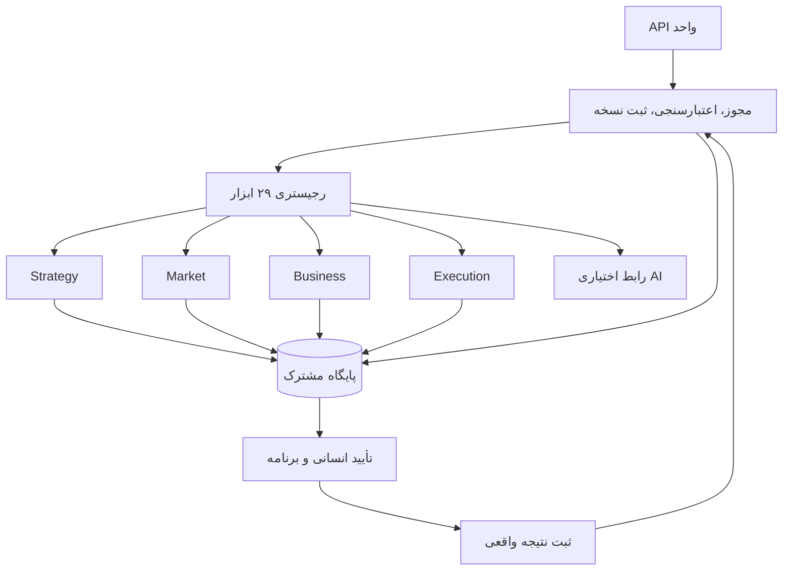

# معماری پایه نهایی M-Tools — v1.0 (بدون UI)

این سند تصمیم‌های معماری لازم برای شروع پیاده‌سازی را تثبیت می‌کند، نه اثبات تجربی محصول. همراه با [بانک شایستگی](marketing-manager-competency-framework.md)، [معماری مفهومی](marketing-decision-pipeline-architecture.md) و [مشخصات ابزارها](marketing-tool-specifications.md) خوانده شود. در تعارض فنی، این سند مقدم است. ۴ موتور، ۲۹ ابزار و ۱۲۰ شناسه بانک بدون تغییر می‌مانند. هیچ UI، کد اجرایی یا زیرساخت واقعی در این مرحله ساخته نمی‌شود.

## ۱. معماری علمی: انتخاب ساده‌ترین روش کافی

هر اجرا یک روش نسخه‌دار دارد. روش‌های تصمیم‌یار مانند ماتریس، بوم و قالب برنامه، مدل علّی اثبات‌شده نیستند. سه نوع خروجی از هم جدا شوند: واقعیت مشاهده‌شده (با شاهد)، برآورد مشروط (با مدل و فرض)، پیشنهاد (با تأیید انسانی). نمره اطمینان مصنوعی تولید نشود.

| خانواده / نسخه | الگوریتم پایه | شرط استفاده و کنترل | منبع |
|---|---|---|---|
| CALC/1 | فرمول‌های قطعی سند مشخصات، مقایسه دوره‌های هم‌تعریف و شمارش یکتا | واحد، ارز، افق و مخرج معتبر؛ هیچ نتیجه بدون ورودی معتبر | R1,R2 |
| SCORE/1 | حذف گزینه‌های ناقض قیود؛ در صورت داده کافی، امتیاز وزنی و تحلیل حساسیت | معیارها، جهت و وزن از قبل تعیین شوند؛ معیارهای هم‌پوشان و داده مفقود بررسی شوند | R3 |
| FORECAST/1 | ابتدا پیش‌بینی ساده آخرین مشاهده یا الگوی فصلی؛ ارزیابی با پنجره زمانی رو به جلو و MAE | بدون داده کافی برای ارزیابی، فقط سناریو؛ مدل پیچیده پیش‌فرض نیست؛ فاصله پیش‌بینی فقط با روش معتبر | R4 |
| EXPERIMENT/1 | طرح آزمون تصادفی دوگروهی؛ تعریف پیشینی متریک، اثر حداقل، حجم و مدت؛ برآورد اختلاف و فاصله اطمینان با روش متناسب با طرح | تخصیص، استقلال/خوشه‌بندی، داده مفقود، انحراف از طرح و آزمون‌های متعدد بررسی شود؛ تحلیل قصد درمان در صورت مناسب بودن؛ غیرتصادفی فقط توصیفی در نسخه اول | R5 |
| RESEARCH/1 | تعیین سؤال، جامعه، روش نمونه‌گیری، ابزار گردآوری، کنترل کیفیت؛ آمار توصیفی یا کدگذاری شواهد کیفی با مرور انسان | نسبت نمونه غیرتصادفی به جامعه تعمیم داده نشود؛ تحلیل مضمون اکتشافی نه اثبات شیوع؛ متن AI جایگزین پاسخ واقعی نیست | R6,R7,R8 |
| HYP/1 | تعریف شکاف، فرضیه‌های رقیب، شواهد موافق/مخالف، آزمون تفکیک‌کننده | بدون آزمون معتبر، علت فرضیه است؛ علت قطعی گزارش نشود | R5 |
| FRAME/1 | قالب‌های استراتژی، بازار، برند و ذی‌نفعان؛ استخراج شواهد، مقایسه گزینه‌ها و ثبت دلیل | قالب کمک‌فکری است؛ ادعا، تمایز، انتخاب و توافق نیازمند شواهد و انسان | R1,R6 |
| PLAN/1 | شکستن کار، مالک و موعد، جمع بودجه، کنترل ظرفیت، تأیید و پایش | قیود سخت کنترل شوند؛ اجرا و تصمیم درباره افراد خودکار نیست | R1,R9,R10 |

### قواعد اجرایی تکمیلی

- SCORE: برای هر معیار کمی با کران از پیش تعیین‌شده L و U و جهت سود، مقدار نرمال‌شده = (x−L)/(U−L)، برای جهت هزینه ۱ منهای آن؛ خارج کران خطای اعتبارسنجی یا تغییر مستند کران (نه قطع پنهان). وزن‌های نامنفی با مجموع ۱؛ امتیاز = مجموع وزن × مقدار نرمال. معیار کیفی فقط با rubric صریح و شاهد. اگر U=L یا داده معیار مؤثر مفقود باشد، رتبه قطعی نده. حساسیت: تغییر وزن در بازه مورد قبول مدیر و نرمال‌سازی مجدد؛ تغییر برنده اعلام شود. این مدل جمع وزنی ساده است، نه MCDA کامل.
- FORECAST: MAE = میانگین قدر مطلق خطا روی نقاط آینده واقعی. پیش‌بینی و آزمون یک افق و تناوب داشته باشند؛ هر مدل فقط با داده قبل از نقطه آزمون ساخته شود. برای پیش‌بینی فصلی وجود دوره‌های کامل لازم است. حداقل تعداد پنجره معتبر به صورت پیشنهادی ۳؛ اگر کمتر باشد، برآورد آزمایشی با هشدار، نه مدل برگزیده معتبر. مقایسه با naive؛ افق و خطا ثبت شوند.
- EXPERIMENT: در نسخه اول فقط آزمون تصادفی دوگروهی مستقل با متریک پیوسته یا دودویی و روش آماری متناسب؛ اختلاف میانگین/نسبت، فاصله اطمینان ۹۵٪ با روش مناسب نمونه (مثلاً Welch برای میانگین تحت شرایط کاربرد؛ روش score/Newcombe برای نسبت مستقل). حجم نمونه با نرخ پایه/واریانس، حداقل اثر، توان و سطح خطای از پیش تعیین‌شده؛ اگر فرض‌ها موجود نیست، طرح ناقص است. تخصیص خوشه‌ای، توقف ترتیبی و آزمون‌های چندگانه خارج از محاسبه خودکار اولیه‌اند و نیاز به متخصص دارند.
- RESEARCH: برای نسبت در نمونه تصادفی ساده، برآورد حجم اولیه n=ceil(z²p(1−p)/e²) فقط با دقت e، سطح اطمینان و p مشخص؛ تصحیح جامعه محدود در صورت نیاز. طرح خوشه‌ای/وزن‌دار یا نمونه غیرتصادفی به این فرمول تقلیل داده نشود. در کدگذاری، شناسه شواهد، کد و یادداشت مرور ثبت شود؛ نتیجه کیفی توسط انسان تأیید شود.
- CALC: تعاریف مالی سند مشخصات حفظ می‌شوند. نقطه سربه‌سر واحد صحیح به بالا گرد شود؛ برای نسبت‌ها مخرج مثبت، برای شمارش عدد صحیح نامنفی، برای مبلغ ارز صریح. درآمد خالص منفی در صورت ثبت بازگشت واقعی قابل قبول است؛ نرخ‌ها در دامنه ۰–۱. CAC و ROMI بدون هزینه/مخرج معتبر نامعلوم؛ ROMI علّی فقط با اثر افزایشی معتبر.
- FRAME/HYP/PLAN: هر ادعای واقعیت باید به شاهد متصل شود؛ گزینه‌ها، متن تولیدشده و امتیاز ذهنی پیش‌نویس‌اند. تحلیلگر انسانی می‌تواند پیشنهاد را رد یا اصلاح کند و دلیل ثبت می‌شود.

## ۲. مدل داده مشترک (یک پایگاه رابطه‌ای)

پیشنهاد فنی: یک برنامه ماژولار و PostgreSQL، با جداول رابطه‌ای برای مالکیت و تاریخچه و JSONB نسخه‌دار برای داده اختصاصی ابزارها. ذخیره فایل در فضای خصوصی برنامه/ذخیره‌ساز سازگار؛ شناسه و checksum در DB. هیچ الزام به سرویس مستقل یا فناوری frontend وجود ندارد.

| موجودیت | فیلدهای کلیدی (حداقل) |
|---|---|
| Workspace | id:UUID، name:text، currency:ISO4217، timezone:IANA، created_at:timestamp |
| Member | workspace_id، user_id، role:owner/editor/viewer؛ کلید مرکب یکتا |
| BusinessProfile | id، workspace_id، version:int، industry، business_model، geography، objectives، constraints:JSON، created_at |
| Product / Segment / Competitor | id، workspace_id، version، name، attributes:JSON، evidence_ids؛ رابطه محصول و بخش در attributes با شناسه معتبر |
| Evidence | id، workspace_id، kind:internal/primary/secondary/assumption، source_uri یا private_file_id، collected_at، period، scope، quality_notes، checksum، sensitivity، created_by |
| Dataset | id، workspace_id، version، evidence_id، schema_version، private_file_id، checksum، row_count، mapping:JSON |
| MetricDefinition | id، workspace_id، version، key، unit، formula_id، direction، grain، window_rule، definition |
| Observation | id، workspace_id، metric_definition_id/version، dataset_id/version، period_start/end، dimensions:JSON، value:decimal/null، unit، currency?، evidence_id؛ دانه‌بندی یکتا |
| Goal | id، workspace_id، metric_definition_id/version، target:decimal، deadline، baseline_observation_id?، owner_id |
| Hypothesis | id، workspace_id، statement، evidence_ids، status:proposed/testing/supported/not_supported/inconclusive، test_run_id? |
| AnalysisRun | id، workspace_id، tool_id، method_id/version، input_snapshot:JSON، dependencies:JSON، input_hash، status، output:JSON، created_by، created_at، model_version? |
| Decision | id، workspace_id، run_id، selected_option، state:draft/approved/rejected/superseded، reason، approved_by?، approved_at? |
| Action | id، workspace_id، decision_id، owner_id، due_date، planned_cost:decimal، currency، goal_id?، status |
| Outcome | id، workspace_id، action_id، observation_id، recorded_at، interpretation |
| AuditEvent | id، workspace_id، actor_id، action، entity_type/id، occurred_at، metadata بدون اطلاعات حساس |

همه شناسه‌ها UUID؛ تاریخ زمان‌دار UTC و تاریخ کسب‌وکار با timezone؛ نسخه‌ها عدد مثبت. رابطه‌های داخلی کلید خارجی مرکب شامل workspace_id داشته باشند. نسخه داده/تعریف/پروفایل پس از استفاده تغییر نکند؛ تغییر نسخه جدید بسازد. فرضیات در Evidence نوع assumption هستند و هیچ‌گاه مشاهده واقعی تلقی نشوند. خروجی‌های ابزارها immutable؛ اصلاح با اجرای جدید و اشاره به نسخه قبلی. حذف داده شخصی/الزام قانونی استثناست: حذف یا بی‌نام‌سازی و ابطال اجرای وابسته، نه حفظ پنهان snapshot حساس.

### قالب داده و اعتبارسنجی

- money: `{amount: decimal-string, currency: ISO4217}`؛ عدد حقیقی مالی با اعشار دقیق؛ تبدیل ارز فقط با نرخ/تاریخ/منبع صریح. count عدد صحیح نامنفی؛ number عدد متناهی؛ date تاریخ ISO؛ text رشته غیرخالی؛ ref شناسه+نسخه شیء مجاز در همان workspace؛ object ساختار JSON ابزار.
- بازه زمانی شروع شامل و پایان غیرشامل؛ آغاز قبل از پایان؛ زمان رویداد و زمان ورود متمایز. حذف تکرار فقط با کلید مشخص، نه شباهت متن.
- داده مشاهده‌شده دارای منبع و تاریخ؛ واحد، تناوب، cohort و تعریف شاخص سازگار. ستون نامعتبر، شناسه مفقود و داده خارج دامنه به کاربر گزارش شود. داده مفقود null، نه صفر. صفر ثبت‌شده معتبر باقی بماند.
- برای فایل CSV: پیش‌نمایش schema، mapping ستون‌ها، کنترل نوع/دانه‌بندی، خطاهای سطری، پذیرش صریح نسخه؛ ورودی خام بی‌صدا اصلاح نشود. فایل‌های بزرگ حد اندازه/زمان و پیام خطا داشته باشند. داده آزمایشی از واقعی جدا.
- داده مشتری ترجیحاً تجمیع یا شناسه مستعار؛ نام، شماره و ایمیل برای تحلیل معمول لازم نیستند. سیاست نگهداشت و حذف در زمان راه‌اندازی سازمان تعیین شود.

## ۳. قرارداد ۲۹ ابزار و ارتباط آن‌ها

فیلدهای زیر قرارداد سطح معماری هستند. نوع object برای ساختارهای اختصاصی است و پیش از کدنویسی هر ابزار schema دقیق زیرکلیدها در کنار تست همان ابزار نوشته می‌شود؛ نه ایجاد یک زبان مدل‌سازی عمومی. همه ابزارها علاوه بر موارد جدول، workspace، سؤال تصمیم، نسخه روش، refs شواهد و constraints مشترک دارند. علامت ? یعنی اختیاری/مشروط، [] آرایه؛ خروجی ? در نبود پیش‌شرط null است. وابستگی‌ها منابع پیشنهادی‌اند نه پیش‌نیاز اجرای اجباری: داده معتبر واردشده دستی جایگزین می‌شود. وابستگی به نسخه اجرای قبلی است؛ چرخه منطقی بین ابزارها باعث اجرای بازگشتی خودکار نمی‌شود.

| ID | ورودی اختصاصی:نوع | منابع خروجی قبلی (اختیاری) | خروجی اختصاصی:نوع | خانواده روش | نمونه معیار پذیرش |
|---|---|---|---|---|---|
| S01 | goal:ref,actual:ref,evidence:ref[] | B05,B03,M04 | gap:number?,hypotheses:object[],next_test:text | HYP | اختلاف واقعی ۷۰ با هدف ۱۰۰ برابر منفی ۳۰؛ هیچ علت بدون آزمون قطعی نیست |
| S02 | product:ref,customer:text,revenue_model:text,cost_model:text | M03,B01 | canvas:object,advantage_hypotheses:object[] | FRAME | نبود داده رقبا یعنی مزیت نامعلوم |
| S03 | goal:ref,problem:text,options:text[],constraints:object | S01,M05,M06,B01,E01 | options:object[],recommendation:text,tradeoffs:text[] | FRAME | گزینه ناقض محدودیت انتخاب نشود |
| S04 | options:object[],criteria:object[] | S03,B06,E01 | ranking:object[],sensitivity:object | SCORE | گزینه خارج بودجه حذف؛ تغییر وزن نتیجه را بازآزمایی کند |
| S05 | baseline:object,assumptions:object[],scenarios:object[] | B02,B01 | scenarios:object[],triggers:text[] | CALC | فرض حجم ۱۰ و قیمت ۵ درآمد ۵۰؛ برچسب سناریو |
| S06 | product:ref,target:ref,goal:ref,channels:object[] | M05,M06,B01,E01 | gtm:object,tests:object[] | FRAME | بدون اقتصاد واحد، توصیه مشروط |
| M01 | question:text,population:text,budget:money?,data:ref[]? | S01 | research_plan:object,findings:object[]? | RESEARCH | بدون پاسخ واقعی فقط طرح تحقیق؛ نمونه سوگیر برچسب بخورد |
| M02 | buyers:count?,frequency:number?,price:money?,scope:text | M01 | tam:money?,sam:money?,som:money?,assumptions:object[] | CALC | ۱۰۰ خریدار × ۲ × ۵ = ۱۰۰۰؛ SAM/SOM از TAM بیشتر نشوند |
| M03 | market:text,competitors:object[],evidence:ref[] | M01 | comparison:object[],risks:object[] | FRAME | قیمت نامعلوم صفر نشود |
| M04 | question:text,evidence:ref[] | M01 | themes:object[],barriers:object[] | RESEARCH | هر مضمون به شاهد واقعی متصل شود |
| M05 | market:text,segments:object[],criteria:object[] | M02,M04,B01 | segments:object[],target:object | SCORE | بخش بدون اندازه یا اقتصاد با عدم قطعیت مشخص شود |
| M06 | target:ref,alternatives:object[],benefits:object[] | M03,M05,M04 | positioning:text,claims:object[],test_plan:object | FRAME | ادعای تمایز بدون شاهد به صورت فرضیه |
| M07 | product:ref,usage:ref?,repeat_purchase:ref?,feedback:ref? | M04,B03 | signals:object[],improvements:object[] | HYP | صرفاً یک شاخص رضایت نباید PMF قطعی بسازد |
| M08 | product:ref,identity:object,evidence:ref[] | M03,M01,M06 | audit:object,perception_gaps:object[] | FRAME | نبود تحقیق ادراک یعنی ممیزی هویت فقط |
| M09 | journey:object[],evidence:ref[] | M04,B03 | pain_points:object[],journey:object[] | RESEARCH | مراحل بدون شاهد فرضی‌اند |
| B01 | revenue:money?,variable_cost:money?,acquisition_cost:money?,new_customers:count?,cohorts:ref?,incremental_margin:money?,campaign_cost:money? | B03,B04 | margin:money?,cac:money?,ltv:money?,romi:number? | CALC | ۲۰۰۰/۲۰=۱۰۰؛ مخرج صفر تعریف‌نشده |
| B02 | unit_price:money,unit_cost:money,fixed_cost:money?,history:ref?,horizon:count? | B01 | break_even:count?,scenarios:object[],forecast:object? | FORECAST | ۱۰۰−۶۰ و ۴۰۰۰ → ۱۰۰ واحد؛ حاشیه منفی بدون سربه‌سر |
| B03 | events:ref,stages:text[],window:object,churn_rule:text? | E04 | funnel:object[],retention:object[],churn:number? | CALC | ۴۰ از ۱۰۰ همان cohort برابر ۰٫۴؛ رویداد تکراری مشتری دوباره نشمرده شود |
| B04 | hypothesis:text,metric:ref,design:object,observations:ref? | S01,B05 | protocol:object,effect:object?,limitations:text[] | EXPERIMENT | بدون داده آزمون فقط پروتکل؛ بدون طراحی معتبر اثر علّی ممنوع |
| B05 | metrics:ref[],observations:ref[],targets:ref[]? | B01,B03,B04 | values:object[],deviations:object[] | CALC | هدف غایب یعنی انحراف نامعلوم |
| B06 | products:object[],options:object[],constraints:object | B01,B02,B04 | portfolio:object[],recommendation:text | SCORE | بازده مشاهده‌ای معادل اثر افزایشی نیست |
| E01 | decision:ref,budget:money,capacity:object[],deadline:date | S03,S04,S06 | actions:object[],allocations:object[],violations:object[] | PLAN | جمع بودجه از سقف بیشتر نشود؛ تصمیم تأییدنشده فقط پیش‌نویس |
| E02 | goal:ref,target:ref,positioning:ref,channels:text[] | M06,M08,E03 | brief:object,content_plan:object[],tests:object[] | PLAN | ادعای بدون شاهد برای انتشار تأیید نشود |
| E03 | goal:ref,budget:money,audience:ref,performance:ref? | S06,B01,B05 | channel_plan:object[],stop_rules:object[] | PLAN | جمع هزینه در سقف؛ نبود داده عملکرد فقط برنامه آزمایشی |
| E04 | product:ref,stages:text[],sales_capacity:object,customer_data:ref? | S06,B03,M09 | launch_plan:object,lifecycle:object[],handoff:object | PLAN | ارسال پیام یا تغییر CRM خودکار انجام نشود |
| E05 | process:text,systems:object[],requirements:object[] | E01 | workflow:object,tool_choices:object[],data_requirements:object[] | PLAN | انتقال داده بدون مجوز مجاز نیست |
| E06 | work:object[],roles:object[],capacity:object[] | E01 | responsibility:object[],development_plan:object[] | PLAN | هر اقدام یک مالک پاسخگو؛ استخدام خودکار ممنوع |
| E07 | issue:text,stakeholders:object[],constraints:object | E06 | discussion_plan:object,options:object[],escalation:text? | FRAME | منافع اظهار نشده فرضیه‌اند |
| E08 | goal:ref,outcomes:ref[],decisions:ref[],risks:object[]? | B05,E01 | review:object,risks:object[],next_actions:object[] | PLAN | انحراف بدون اثبات علت؛ اصلاح نیازمند تأیید |

### قرارداد مشترک

```text
RunRequest {
  workspace_id, tool_id, question,
  method_version, input, evidence_refs[],
  dependency_run_ids[], idempotency_key
}
RunResult {
  run_id, status, method_id, method_version,
  input_hash, findings[], options[], assumptions[],
  evidence_refs[], limitations[], missing_fields[],
  output, next_action, error_code?
}
```

status اجرایی: queued/running/succeeded/failed؛ status تحلیلی مستقل: ready/conditional/needs_data/error. نیازمند داده یک نتیجه معتبر است، نه خطای شبکه. finding دارای kind:observed/estimate/hypothesis/recommendation، value، evidence_refs و assumption_refs. یافته مشاهده‌ای بدون شاهد رد می‌شود. ورودی schema نامعتبر: خطای مشخص فیلد، نه تحلیل. نتیجه مشروط برای فرض‌های قابل اعلام؛ فقدان پیش‌شرط ضروری به needs_data منجر شود.

## ۴. معماری نرم‌افزار



Modular monolith: چهار ماژول دامنه، core مشترک، repository داده، registry روش‌ها و adapter اختیاری AI. یک worker در همان codebase فقط برای کار طولانی؛ در آغاز صف مبتنی بر DB کافی است. هیچ agent مستقل، orchestrator پیچیده، vector DB یا microservice لازم نیست. هسته محاسبات علمی با CPython 3.12.x طراحی می‌شود؛ candidateهای اصلی NumPy 2.3.5، pandas 2.3.3، SciPy 1.15.3، scikit-learn 1.9.1 و Statsmodels 0.14.5 هستند. backend وب Django و رابط React/TypeScript گزینه‌های اصلی‌اند. Meridian در صورت فعال‌سازی به‌دلیل تعارض ArviZ با PyMC-Marketing در virtualenv/worker جدا اجرا می‌شود؛ این microservice دامنه‌ای جدید ایجاد نمی‌کند. نسخه‌های دقیق پس از resolver و lockfile تثبیت می‌شوند. ارائه‌دهنده AI مستقل از هسته علمی و قابل تعویض می‌ماند.

رجیستری هر ابزار شامل tool_id، input_schema، output_schema، method_id/version، validate، run، تست مرجع. تابع run روی snapshot فقط می‌خواند و خروجی تحلیلی می‌دهد؛ اثر بیرونی، پرداخت، انتشار، ارسال یا تغییر CRM در آن ممنوع. محاسبات قطعی از مدل زبانی مستقل؛ AI فقط روی داده مجاز برای خلاصه‌سازی/پیشنهاد، پاسخ JSON اعتبارسنجی‌شده و ثبت نسخه مدل/پرامپت. شکست AI به نتیجه ناقص یا خطای مشخص منجر شود، نه حدس عدد.

### API حداقلی (REST، JSON)

| عملیات | مسیر | رفتار |
|---|---|---|
| پروفایل و موجودیت‌ها | GET/POST /workspaces/{wid}/entities/{type} | فهرست و ایجاد نسخه؛ type فقط enum مجاز |
| نسخه موجودیت | GET/PATCH /workspaces/{wid}/entities/{type}/{id} | خواندن؛ اصلاح با نسخه جدید و کنترل هم‌زمانی |
| ورود داده | POST /workspaces/{wid}/datasets | اعتبارسنجی، staging و تأیید نسخه جداگانه |
| کاتالوگ | GET /tools و GET /tools/{id} | metadata و schema، بدون داده مشتری |
| اجرای تحلیل | POST /workspaces/{wid}/runs | ثبت snapshot؛ پاسخ 201 یا 202 با run_id |
| نتیجه | GET /workspaces/{wid}/runs/{id} | وضعیت و خروجی ثابت |
| تصمیم | POST /workspaces/{wid}/decisions و POST /workspaces/{wid}/decisions/{id}/approve | پیش‌نویس و تأیید صریح مالک مجاز |
| اقدام و نتیجه | POST /workspaces/{wid}/actions و POST /workspaces/{wid}/outcomes | ثبت برنامه تأییدشده و شواهد نتیجه |

خطاها: 400 بدنه خراب، 401 بدون هویت، 403 بی‌مجوز، 404 شیء ناموجود/خارج workspace، 409 تضاد نسخه یا کلید تکرار با payload متفاوت، 422 ورودی نامعتبر، 429 محدودیت مصرف، 503 خرابی وابستگی. پیام عمومی بدون stack trace یا داده حساس.

### اجرای یک تحلیل

۱. احراز هویت و مجوز شیء؛ ۲. ثبت snapshot نسخه‌های ورودی و refs؛ ۳. اعتبارسنجی؛ ۴. محاسبه/تحلیل با روش ثبت‌شده؛ ۵. اعتبارسنجی خروجی و شواهد؛ ۶. ذخیره اتمیک نتیجه؛ ۷. نمایش نتیجه برای تأیید (خارج از دامنه UI فعلی)؛ ۸. ثبت تصمیم و اقدام در تراکنش جدا.

Idempotency key در workspace یکتا؛ درخواست تکراری همان payload همان run را بازگرداند. payload متفاوت با همان کلید 409. hash از JSON canonical و نسخه روش/ورودی؛ AI غیرقطعی است و بازتولید لفظ‌به‌لفظ تضمین نمی‌شود؛ خروجی اصلی نگه داشته شود. خطای موقت حداکثر ۲ retry با backoff؛ اعتبارسنجی یا عدم مجوز retry نشود. برای worker، claim اتمیک job، lease و بازیابی کار رهاشده؛ هیچ اقدام بیرونی در retry. تغییر داده بالادستی، نتیجه قبلی را stale نشان دهد و اجرای جدید با تأیید کاربر، نه بازنویسی خودکار.

## ۵. امنیت، حریم خصوصی و عملیات

- owner مدیریت اعضا و تأیید تصمیم؛ editor ورود داده/تحلیل/پیش‌نویس؛ viewer خواندن فقط. نقش و مالکیت workspace در هر درخواست و هر ref بررسی شود؛ شناسه به تنهایی مجوز نیست.
- احراز هویت با سازوکار استاندارد یا ارائه‌دهنده معتبر؛ TLS، اسرار در secret/env، رمزگذاری ذخیره و backup؛ فایل خصوصی با دسترسی موقت و کنترل مالکیت.
- لاگ فقط شناسه، وضعیت، زمان و کد خطا؛ متن مصاحبه، اطلاعات شخصی، توکن و داده مالی خام وارد لاگ نشوند. خروجی CSV در برابر formula injection ایمن شود؛ فایل ورودی محدود به قالب مجاز.
- AI خارجی پیش‌فرض بدون داده حساس؛ سیاست ارائه‌دهنده/رضایت و مجوز قبل از ارسال، کمینه‌سازی و حذف شناسه‌های مستقیم. متن وب و فایل ورودی داده غیرقابل اعتماد است؛ دستور داخلی آن اجرا نشود. ابزار AI اجازه اجرای اقدام یا دسترسی آزاد DB ندارد.
- حذف و خروجی داده سازمان، کنترل retention، backup دوره‌ای و آزمون بازیابی؛ ثبت رخداد دسترسی/تأیید؛ محدودیت نرخ و حجم؛ مجوزهای حقوقی، حوزه قضایی و سیاست نگهداشت پیش از بهره‌برداری تعیین شوند. معماری به تنهایی ادعای انطباق قانونی نیست.

## ۶. اعتبارسنجی و معیار آمادگی پیاده‌سازی

- [x] ۲۹ قرارداد سطح معماری و نمونه معیار پذیرش؛ پوشش ۱۲۰ شناسه در سند قبلی.
- [x] روش پایه و محدوده اعتبار، مدل داده و وابستگی نسخه‌دار، جریان اجرا، API، خطا و امنیت طراحی شده‌اند.
- [ ] برای هر ابزار پیش از توسعه: زیرکلیدهای object در JSON Schema، migration و تست دقیق تعریف شود.
- [ ] تست واحد فرمول، حالت صفر/مفقود/ارز متفاوت/زمان و cohort ناسازگار؛ تست قرارداد هر ابزار با ورودی صحیح، ناقص، نامعتبر.
- [ ] تست یکپارچه مسیر M01→M05→M06→S03→E01→Outcome و مسیر B03→S01→B04→B05؛ داده مصنوعی با برچسب، خروجی از پیش محاسبه‌شده.
- [ ] تست جداسازی workspace، مجوز شیء، تکرار درخواست، شکست AI، منبع جعلی، حذف داده، بازیابی backup.
- [ ] مرور متخصص بازار/مالی/آمار برای روش‌های مرتبط؛ پایلوت حداقل با نمونه کسب‌وکار خدماتی و فروشگاهی و داده واقعی مجاز؛ معیار نتیجه پیش از آزمون تعیین شود. هیچ ادعای علمی اثربخشی یا بهبود درآمد تا شواهد کافی مطرح نشود.

MVP همان ۸ ابزار سند مشخصات و سنجش پایه مشترک باقی می‌ماند؛ ۲۱ ابزار دیگر بر اساس نیاز اضافه می‌شوند. معماری توسعه برای هر ۲۹ تعریف شده، اما ساخت همه در یک مرحله لازم نیست.

## ۷. منابع بررسی‌شده در ۲۴ نوامبر ۲۰۲۶

- R1: [OpenStax Marketing Plan](https://openstax.org/books/principles-marketing/pages/2-3-purpose-and-structure-of-the-marketing-plan)، [Marketing Metrics](https://openstax.org/books/principles-marketing/pages/2-4-marketing-plan-progress-using-metrics)، [Positioning](https://openstax.org/books/principles-marketing/pages/5-6-product-positioning)؛ چارچوب آموزشی برنامه‌ریزی، سنجش و STP.
- R2: [SBA Break-even](https://legacy.sba.gov/business-guide/plan-your-business/calculate-your-startup-costs/break-even-point)؛ فرمول سربه‌سر.
- R3: [Government Analysis Function MCDA](https://analysisfunction.civilservice.gov.uk/policy-store/an-introductory-guide-to-mcda/)؛ مقایسه معیارها و حساسیت؛ فرمول ساده پروژه انتخاب طراحی است.
- R4: [Forecasting: Principles and Practice](https://otexts.com/fpp3/toolbox.html)؛ روش پایه و ارزیابی پیش‌بینی.
- R5: [HM Treasury Magenta Book](https://www.gov.uk/government/publications/the-magenta-book/magenta-book-central-government-guidance-on-evaluation-html) و [Annex A](https://www.gov.uk/government/publications/the-magenta-book/magenta-book-annex-a-analytical-methods-for-use-within-an-evaluation-html)؛ طراحی ارزیابی و تمایز استنتاج علّی از توصیف.
- R6: [AAPOR Best Practices](https://aapor.org/standards-and-ethics/best-practices/)؛ کیفیت و شفافیت تحقیق پیمایشی.
- R7: [OpenStax Marketing Research Plan](https://openstax.org/books/principles-marketing/pages/6-3-steps-in-a-successful-marketing-research-plan)؛ فرایند تحقیق.
- R8: [Braun & Clarke — Doing Reflexive TA](https://www.thematicanalysis.net/doing-reflexive-ta/)؛ تحلیل مضمون به عنوان فرایند تفسیری؛ کدگذاری ساده پروژه ادعای اجرای کامل روش بازتابی ندارد.
- R9: [OPM Structured Interviews](https://www.opm.gov/policy-data-oversight/assessment-and-selection/structured-interviews/)؛ ساختار مصاحبه شغلی.
- R10: [NIST AI RMF Core](https://airc.nist.gov/airmf-resources/airmf/5-sec-core/) و [OWASP Object Authorization](https://api-security.owasp.org/editions/2023/en/0xa1-broken-object-level-authorization/)؛ کنترل ریسک AI و دسترسی شیء.

این منابع خانواده روش‌ها را پشتیبانی می‌کنند؛ اعتبارسنجی جزءبه‌جزء الگوریتم‌های آماری و ابزارهای پیاده‌شده، منابع اختصاصی برای روش‌های پیشرفته و شواهد تجربی شرکت‌ها همچنان جزو معیار انتشار هستند. سند baseline قابل توسعه است، نه استاندارد علمی نهایی.

## ۸. تکمیل معماری برای حساب، پروفایل و پایپلاین — v1.1

مکمل [UX v1.1](marketing-ux-design-v1.md). هر کسب‌وکار معادل یک Workspace است، نه یک حساب. حساب کاربر مستقل و عضویت چندبه‌چند است. همه تحلیل‌ها به Workspace تعلق دارند.

| موجودیت افزوده | فیلد حداقلی |
|---|---|
| User | id، identity_provider_subject یکتا، display_name، verified_email، status، created_at |
| PipelineRun | id، workspace_id، mode:domain/full، selected_domain?، goal_id?، question، profile_version، plan_version، state، created_by، created_at |
| PipelineStep | id، workspace_id، pipeline_run_id، tool_id، dependency_step_ids، state، analysis_run_id?، input_refs، reason?، position |

هویت و بازیابی رمز با ارائه‌دهنده استاندارد؛ رمز خام در پایگاه برنامه ذخیره نشود. ایجاد Workspace و عضویت owner در یک تراکنش. کاربر فقط Workspace دارای عضویت فعال را انتخاب می‌کند. پروفایل، محصول، شواهد، هدف و داده مالی از موجودیت‌های موجود استفاده می‌کنند؛ مدل داده موازی ایجاد نشود.

### قراردادهای افزوده

| عملیات | مسیر |
|---|---|
| ورود، ثبت‌نام، تأیید ایمیل، خروج، بازیابی | مسیرهای استاندارد ارائه‌دهنده هویت |
| حساب فعلی | GET /me |
| فهرست و ایجاد کسب‌وکار | GET/POST /workspaces |
| پیش‌نمایش طرح تحلیل | POST /workspaces/{wid}/pipeline-previews |
| ایجاد پایپلاین از طرح تأییدشده | POST /workspaces/{wid}/pipelines |
| وضعیت و نتایج مراحل | GET /workspaces/{wid}/pipelines/{id} |
| توقف، ادامه، اصلاح طرح | POST /workspaces/{wid}/pipelines/{id}/{command} |

فرمان فقط enum pause/resume/revise؛ تغییر طرح نسخه جدید ثبت می‌کند. اجرای تکی از API runs موجود استفاده می‌کند. در پیش‌نمایش، دامنه انتخابی، ابزارها، وابستگی‌های واقعی، پیش‌شرط داده، ابزار غیرقابل اجرا و نقاط تأیید ثبت می‌شوند. پیش‌نمایش نه اجراست و نه هزینه بیرونی ایجاد می‌کند.

### اجرای ساده بدون orchestrator مستقل

پایپلاین یک فهرست مراحل نسخه‌دار با گراف وابستگی بدون چرخه در سطح اجرای مشخص است؛ چرخه مفهومی ابزارها با ارجاع به خروجی قبلی حل می‌شود. پیش از اجرا اعتبار گراف، عضویت، نسخه داده و فعال بودن ابزار بررسی شود. همان registry و worker موجود مرحله‌های آماده را اجرا می‌کنند؛ نیاز به سرویس جدید نیست.

وضعیت مرحله: pending/running/completed/conditional/needs_data/awaiting_approval/failed/skipped/unavailable. توقف از زمان‌بندی مرحله جدید جلوگیری می‌کند؛ اجراهای در جریان ممکن است کامل شوند و نتیجه محفوظ بماند. ادامه، مرحله موفق را بی‌دلیل تکرار نمی‌کند؛ اجرای جدید فقط در صورت تغییر نسخه یا درخواست بازتحلیل. مرحله مشروط فقط با پذیرش محدودیت و برقراری پیش‌شرط مرحله بعد قابل استفاده است؛ مرحله needs_data و unavailable وابسته‌ها را مسدود می‌کنند. شاخه مستقل ادامه می‌یابد. اگر داده تازه وارد شد، snapshot جدید و بازبینی وابستگان، نه تغییر خروجی قدیمی. تأیید انسانی جدا از موفقیت پردازش است؛ هیچ تأیید، ارسال، انتشار یا پرداخت خودکار نیست.

پایپلاین جامع پوشش چهار حوزه دارد، با ابزارهای مرتبط و مجاز؛ در MVP فقط هشت ابزار فعال‌اند و سایر مراحل در دست توسعه مشخص می‌شوند. گزارش نهایی شناسه اجراها، شواهد، نتایج جزئی، وضعیت پوشش، محدودیت‌ها، تعارض و اقدام‌های پیشنهادی را نگه می‌دارد؛ خروجی ناقص «جامع کامل» نامیده نشود.

تست‌های الزامی افزوده: ورود و بازیابی، چند Workspace مستقل، عدم دسترسی بین Workspaceها، ایجاد اتمیک مالک، اجرای تکی/حوزه/جامع، توقف/ادامه، وابستگی مسدود، شاخه مستقل، تأیید انسانی و تغییر نسخه. این بخش قرارداد طراحی است و هنوز کدنویسی یا آزمون نشده است.

## سیاست ثابت انتخاب کتابخانه و مجوز (تصمیم مالک پروژه)

**Capability-first, license-aware, release-gated.** هدف در طراحی و تحقیق، انتخاب بهترین روش، الگوریتم، کتابخانه، مدل یا مؤلفه برای نیاز واقعی محصول است؛ نه محدود کردن امکانات بر اساس رایگان بودن یا قیمت مجوز. این تصمیم برای همه ۲۹ ابزار، چهار موتور، زیرساخت و نسخه‌های آینده معتبر است و نباید در هر جلسه دوباره از مالک پروژه پرسیده شود.

- در طراحی و مقایسه، گزینه‌های متن‌باز، تجاری، پولی، دارای مجوز دوگانه و اختصاصی همگی مجاز به بررسی و انتخاب معماری هستند. صرف تجاری بودن یا هزینه مجوز، دلیل حذف یا کاهش امتیاز فنی نیست. کیفیت علمی، تناسب، سادگی، امنیت، نگهداری و قابلیت یکپارچه‌سازی همچنان معیارند؛ کتابخانه غیرضروری اضافه نشود.
- در توسعه، ارزیابی و نمونه‌سازی از نسخه‌هایی که شرایطشان اجازه می‌دهد، از جمله نسخه آزمایشی یا مجوز توسعه معتبر، استفاده شود. تصمیم خرید مجوز صرفاً لازم برای انتشار/بهره‌برداری تجاری تا نزدیک انتشار به تعویق می‌افتد. اگر مجوز از مرحله توسعه، کپی، یکپارچه‌سازی، میزبانی یا توزیع لازم باشد، همان مرحله باید رعایت شود؛ خصوصی بودن مخزن یا عدم انتشار محصول مجوز ایجاد نمی‌کند. در نبود اجازه، مؤلفه در طراحی باقی می‌ماند و رابط/نمونه جایگزین مستقل ساخته می‌شود یا مجوز مناسب اخذ می‌گردد. دور زدن مجوز یا کپی کد بدون اجازه ممنوع است.
- به ازای هر وابستگی منتخب، در رجیستری وابستگی‌ها نام، نسخه، منبع، کاربرد، نوع مجوز و شروط استفاده توسعه/انتشار، وضعیت مجوز، هزینه احتمالی و مسیر اخذ یا جایگزین ثبت شود. مجوز نامشخص به معنی مجاز نیست؛ شرایط وابستگی‌های غیرمستقیم، مدل‌ها، وزن‌ها، داده‌ها و دارایی‌ها نیز در صورت کاربرد بررسی شود. ثبت این موارد نباید موجب فیلتر خودکار گزینه‌های پولی از طراحی شود.
- یکپارچه‌سازی در مرز ماژول یا adapter ساده و قابل تعویض باشد؛ بدون ساخت لایه انتزاعی اضافی برای هر کتابخانه.
- **Release gate:** پیش از انتشار عمومی، ارائه SaaS به مشتری، توزیع یا بهره‌برداری تجاری (و هر مرحله زودتری که مجوز الزام کند)، بررسی همه وابستگی‌ها، تهیه مجوزهای لازم، رعایت شروط توزیع/اعلان/انتساب و ثبت تأیید مالک الزامی است. اگر مجوز قابل اخذ یا سازگار نیست، آن بخش باید قبل از استفاده مربوطه جایگزین یا غیرفعال شود. مجوزهای ضروری توسعه از این تعویق مستثنا هستند.

مراجع برای تفاوت مشاهده کد عمومی و مجوز استفاده، و نمونه مجوز توسعه: [GitHub — Licensing a repository](https://docs.github.com/en/repositories/managing-your-repositorys-settings-and-features/customizing-your-repository/licensing-a-repository)؛ [SurveyJS Licensing FAQ](https://surveyjs.io/faq/licensing). شرایط هر مؤلفه و نسخه باید مستقلاً بررسی شود. این سیاست، انتخاب معماری را تثبیت می‌کند و به معنی اجازه قانونی استفاده از همه مؤلفه‌ها نیست.


## ۹. مرجع فناوری و سازگاری علمی

انتخاب دقیق کتابخانه‌ها، نسخه‌ها، APIهای واقعی، محدودیت‌های داده و برنامه آزمون ۲۹ ابزار در [Scientific Engine & Technology Specification](marketing-scientific-engine-specification.md) نگهداری می‌شود. baseline پیشنهادی علمی CPython 3.12.x است؛ NumPy 2.3.5، pandas 2.3.3، SciPy 1.15.3 و Statsmodels 0.14.5 برای اشتراک محدودیت‌های DoWhy، StatsForecast و Meridian انتخاب شده‌اند. PyMC-Marketing و Meridian به‌دلیل تعارض ArviZ در environmentهای جدا اجرا می‌شوند. baseline جدید هنوز به‌دلیل محدودیت اعتبار CI نصب و lock نشده؛ نسخه‌ها candidate هستند و نباید runtime تأییدشده معرفی شوند. شواهد و انتخاب روش ۲۹ ابزار در [مرور پژوهش](marketing-29-tools-evidence-review.md) است.


## ۱۰. Strategy Library — مسیرهای استراتژی بر موتور موجود
[کتابخانه استراتژی](marketing-strategy-library.md) مرجع ۲۶ recipe تخصصی، شواهد، KPI و مراحل عملی است. هیچ ابزار یا موتور جدیدی ساخته نمی‌شود. recipe نسخه‌دار در catalog کد تعریف می‌شود؛ PipelineRun فیلدهای اختیاری recipe_id/recipe_version و PipelineStep نقش stage_key/output binding دارد. mode همان domain/full است؛ single مستقل باقی می‌ماند. API پیش‌نمایش موجود recipe_id/version را می‌پذیرد. گزارش ترکیبی موجود StrategyResult را طبق قرارداد کتابخانه تولید می‌کند؛ جدول یا سرویس مستقل لازم نیست. S03 مالک انتخاب استراتژیک با تایید انسان؛ E01 مالک طرح مصوب؛ پیش‌نویس گزینه‌ها قبل از تایید قابل تهیه است، اما اجرا/انتشار/خرید خودکار ممنوع است. وابستگی به شناسه artifact مرحله قبلی است؛ مرور E08 نسخه بعدی می‌سازد، نه چرخه در DAG. catalog از وضعیت واقعی ابزارها coverage را استخراج می‌کند. MVP همان ۸ ابزار و ثبت KPI پایه؛ مسیرهای تخصصی ناتمام به‌عنوان draft/partial نشان داده شوند. قرارداد موتور علمی، امنیت و سیاست مجوز بدون تغییر.
